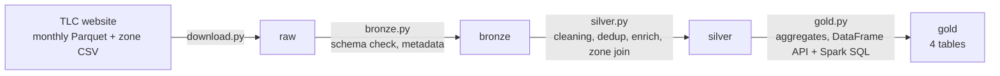

# NYC Taxi Medallion Pipeline (PySpark)

A batch ETL pipeline that processes NYC TLC Yellow Taxi trip data with **PySpark** using the **Medallion Architecture** (raw → bronze → silver → gold). It runs locally in Docker and includes data quality rules, row-level reconciliation, four analytical gold tables and a simple partitioning benchmark.

## Architecture



| Layer | What it holds |
|---|---|
| **raw** | Original monthly Parquet files and `taxi_zone_lookup.csv`, downloaded idempotently |
| **bronze** | Source data as-is + metadata columns (`_ingested_at`, `_source_file`). Fail-fast schema check across months, row count check (raw = bronze) |
| **silver** | Cleaned, deduplicated, snake_case columns, derived columns (km, duration, speed, date, hour), code descriptions, pickup/dropoff zones (broadcast join). Read-back and reconciliation checks |
| **gold** | Four aggregated tables for business questions, each verified after write |

## Tech Stack

Python · PySpark 4.3.0 · Spark SQL · Parquet · Docker / Docker Compose · Jupyter · Git

## Dataset

- **Source:** [NYC TLC Trip Record Data](https://www.nyc.gov/site/tlc/about/tlc-trip-record-data.page), Yellow Taxi, **January–March 2024** (9,554,778 rows) + taxi zone lookup (265 zones).
- **Data dictionary** (code descriptions): [TLC Yellow Taxi data dictionary](https://www.nyc.gov/assets/tlc/downloads/pdf/data_dictionary_trip_records_yellow.pdf)
- All distances and speeds are converted to **kilometers** (1 mile = 1.609344 km).

## How to Run

Requirements: Docker Desktop, Git.

```bash
git clone https://github.com/samet-usta/nyc-taxi-medallion.git
cd nyc-taxi-medallion
docker compose up -d

docker compose exec spark python src/download.py
docker compose exec spark spark-submit --driver-memory 4g src/bronze.py
docker compose exec spark spark-submit --driver-memory 4g src/silver.py
docker compose exec spark spark-submit --driver-memory 4g src/gold.py
```

- Jupyter: http://localhost:8888 (token is set in `docker-compose.yml`), Spark UI: http://localhost:4040
- The months to process are set in `src/config.py`.
- On Git Bash (Windows), prefix commands that pass container paths with `MSYS_NO_PATHCONV=1`.

## Data Quality Rules (silver)

| # | Rule | Dropped rows |
|---|---|---:|
| 1 | `fare_amount <= 0` | 139,596 |
| 2 | `total_amount <= 0` | 117,187 |
| 3 | Dropoff before pickup | 180 |
| 4 | Zero duration | 2,621 |
| 5 | Pickup month outside the file's month | 56 |
| 6 | Duration > 180 min | 6,103 |
| 7 | Distance > 150 km | 271 |
| 8 | Average speed > 120 km/h | 3,377 |
| 9 | Exact duplicates (all source columns) | 1 |

A row can match more than one rule; rows dropped by rules 1–8 total **151,534 (1.59%)**.

**Reconciliation (checked on every run):** bronze 9,554,778 = silver 9,403,243 + dropped by rules 151,534 + duplicates 1.

Kept on purpose: zero-distance trips with a positive amount, zero-passenger trips, and **Flex Fare** trips (`payment_type = 0`), whose nullable columns stay null.

Other silver decisions:
- All source columns renamed to snake_case (e.g. `tpep_pickup_datetime` → `pickup_datetime`, `PULocationID` → `pickup_location_id`, `trip_distance` → `trip_distance_miles`).
- `payment_type` and `ratecode_id` get readable descriptions (`payment_type_desc`, `ratecode_desc`); unknown codes become `"Unmapped"`.
- Zones are added with two **broadcast** left joins; the lookup key is checked to be unique (fail fast).

## Gold Tables

| Table | Grain | Rows | Notes |
|---|---|---:|---|
| `daily_zone_revenue` | day × pickup zone | 20,608 | trips, total and average revenue (`total_amount`) |
| `hourly_demand` | ISO day of week (1 = Monday) × hour | 168 | trips and average trips per day (`trip_count / day_count`) |
| `payment_type_summary` | payment type | 5 | trip share (window function) and tip rate |
| `route_summary` | pickup zone → dropoff zone (directed) | 36,739 | trips, avg distance/duration, revenue; written with **Spark SQL** |

Every gold table is read back after write (row count + schema) and its `sum(trip_count)` is checked against silver.

Notes:
- Zones 264 (Unknown) and 265 (Outside of NYC) are kept in count and revenue tables. `route_summary` excludes trips touching zone 264 (no route information); 265 stays.
- Ratios are **ratio of sums**: e.g. tip rate = `sum(tip_amount) / sum(fare_amount)`. When combining rows, do not average the `avg_*` columns; use `sum(total_revenue) / sum(trip_count)`.
- Cash tips are not recorded by TLC, so the cash tip rate is `null` (no data), not 0.
- `hourly_demand`: Sunday 02:00 has 12 days instead of 13 because of the DST change on 10 March 2024; `day_count` handles it.

**Top 5 routes:**

| Pickup zone | Dropoff zone | Trips | Avg km | Avg min |
|---|---|---:|---:|---:|
| Upper East Side South | Upper East Side North | 63,767 | 1.70 | 7.16 |
| Upper East Side North | Upper East Side South | 56,627 | 1.67 | 7.97 |
| Upper East Side North | Upper East Side North | 46,338 | 1.00 | 4.67 |
| Upper East Side South | Upper East Side South | 43,087 | 1.01 | 5.52 |
| Midtown Center | Upper East Side South | 30,778 | 1.72 | 9.07 |

**Payment types:**

| Payment type | Trips | Share % | Tip rate % |
|---|---:|---:|---:|
| Credit card | 7,251,232 | 77.11 | 22.41 |
| Cash | 1,297,943 | 13.80 | null |
| Flex Fare | 729,735 | 7.76 | 4.82 |
| Dispute | 81,705 | 0.87 | 0.08 |
| No charge | 42,628 | 0.45 | 0.05 |

## Insights

- **Airports earn the most:** JFK ($33.8M) and LaGuardia ($18.8M) are the top revenue pickup zones, although Midtown Center has more trips.
- **Why?** Airport trips are ~5.5× longer (21.3 km vs 3.9 km) and carry higher extra fees ($12.04 vs $5.25). The tip rate is almost the same (16.7% vs 17.9%), so the revenue gap comes from **distance**, not from more generous passengers. *(Tip rates include cash trips, whose tips are not recorded.)*
- The busiest routes are short trips inside Manhattan's Upper East Side; routes are directed because the two directions differ (63,767 vs 56,627).

## Performance: Partitioning

Notebook: `notebooks/03_partitioning_benchmark.ipynb`. Silver was rewritten with `partitionBy("pickup_year", "pickup_month")` and the same one-month query (February 2024, `sum(total_amount)`) was run on both versions, 5 times each (first run = warm-up, median of the other 4).

| Scenario | Files on disk | Files scanned for Feb 2024 | Median |
|---|---|---|---:|
| Non-partitioned | 14 (323 MB) | all 14 | 0.32 s |
| Partitioned (`pickup_year` / `pickup_month`) | 42 (14 per month) | 14 (`pickup_month=2` only) | 0.23 s |

- `explain()` shows **partition pruning**: on the partitioned data the month filter is in `PartitionFilters` and only one folder is listed; on the non-partitioned data it is in `PushedFilters` and every file is opened.
- ~28% faster on 323 MB locally; the gap grows with more data and more months.
- **Small files:** each write task produced one file per month (~7 MB files). Fix: `repartition("pickup_year", "pickup_month")` before writing.

## Project Structure

```
nyc-taxi-medallion/
├── docker-compose.yml
├── src/
│   ├── config.py          # paths, year and months
│   ├── spark_session.py   # shared SparkSession
│   ├── download.py
│   ├── bronze.py
│   ├── silver.py
│   └── gold.py
├── notebooks/             # exploration and benchmark (notes in Turkish)
└── data/                  # not in Git: raw / bronze / silver / gold
```

## Lessons Learned

- Fail fast: schema, uniqueness and row count checks stop the job before bad data reaches the next layer.
- Reconciliation (`bronze = silver + dropped`) makes every removed row explainable.
- Spark Parquet reads every column as nullable, so read-back checks compare column names and types only.
- `timestamp_ntz` keeps NYC local time without timezone shifts (visible in the DST hour).
- Partitioning helps only when queries filter on the partition columns, and it can create small files.

## Next Steps

- Run all 12 months of 2024.
- Single entry point for the whole pipeline.
- Fix small files with `repartition` before `partitionBy`.
